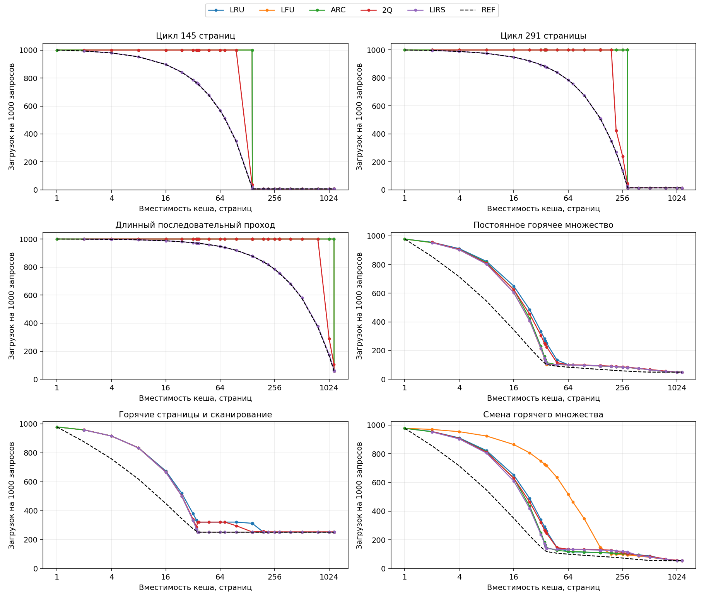
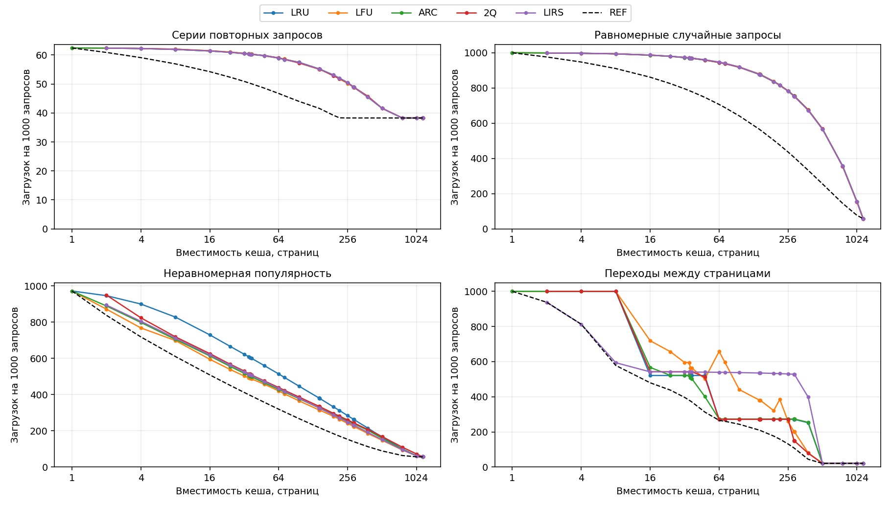
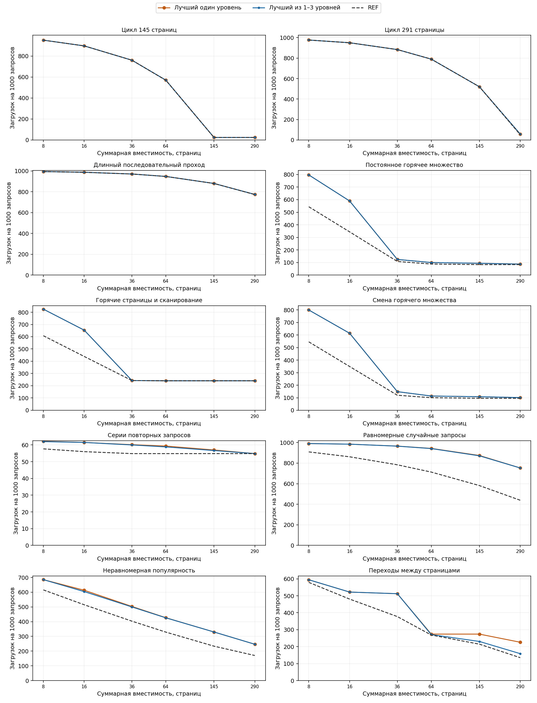
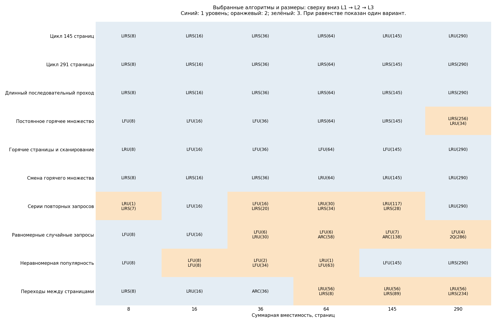

# Cache Research

- [Описание проекта](#описание-проекта)
- [Исследование №1: Влияние размера одноуровневого кеша на выбор алгоритма вытеснения](#исследование-1-влияние-размера-одноуровневого-кеша-на-выбор-алгоритма-вытеснения)
- [Исследование №2: Поиск оптимальной системы в приближении к процессорной иерархии кеша](#исследование-2-поиск-оптимальной-системы-в-приближении-к-процессорной-иерархии-кеша)
  - [Наиболее оптимальные сочетания алгоритмов](#наиболее-оптимальные-сочетания-алгоритмов)
  - [Даёт ли сочетание алгоритмов выигрыш](#даёт-ли-сочетание-алгоритмов-выигрыш)
- [Исследование №3: Бесплатный доступ к уровням](#исследование-3-бесплатный-доступ-к-уровням)
- [Общий вывод](#общий-вывод)
- [Сборка и запуск](#сборка-и-запуск)
  - [1. Подготовка](#1-подготовка)
  - [2. Сборка бенчмарков](#2-сборка-бенчмарков)
  - [3. Генерация и запуск одного случая](#3-генерация-и-запуск-одного-случая)
  - [4. Запуск полных исследований](#4-запуск-полных-исследований)
  - [5. Собственная последовательность запросов](#5-собственная-последовательность-запросов)
  - [6. Сборка и запуск тестов](#6-сборка-и-запуск-тестов)
  - [7. Запуск приложения](#7-запуск-приложения)
  - [8. Сборка через Nix](#8-сборка-через-nix)
  - [9. Использование кеша как библиотеки](#9-использование-кеша-как-библиотеки)

## Описание проекта

Данный проект посвящен исследованию алгоритмов кеширования **LRU (least recently used), LFU (least frequently used), ARC (adaptive replacement cache), 2Q (two queue) и LIRS (low-inference recency set)**, а также многоуровневых систем, включающих данные алгоритмы с целью нахождения оптимальной системы при различных паттернах использования.

[Описания алгоритмов вытеснения и паттернов использования кеша](cacheBenchmarks/reports/METHODOLOGY.md)

Во всех исследованиях использовались страницы одинакового размера, кеши изначально были пусты, первые загрузки учитывались.

**Горячее множество** — набор часто запрашиваемых страниц.
**REF** — идеальный алгоритм кеширования (алгоритм Белади), заранее знающий будущие запросы и вытесняющий ту страницу, которая встретится позже других.
Данный алгоритм использовался как эталонный для сравнения с построенными нами системами.

## Исследование №1: Влияние размера одноуровневого кеша на выбор алгоритма вытеснения

**Задача:** выявление оптимального алгоритма при заданной вместимости кеша и количеству обращений.

Проверены 30 различных вместимостей и 10 видов запросов: по 20 000 обращений и пять
начальных значений генератора случайных страниц. Метрика — среднее число загрузок из источника
на 1000 запросов; время поиска в кеше не учитывается.

На графиках по горизонтали — вместимость кеша в логарифмическом масштабе,
по вертикали — количество загрузок на 1000 запросов. Пунктир обозначает идеальный алгоритм кеширования REF (алгоритм Белади).





**Лидеры при трёх характерных размерах.** В ячейке указаны наиболее оптимальные алгоритмы
и их эффективность в процентах относительно идеального кеширования REF (алгоритма Белади) при той же вместимости на одинаковых запросах.

**Эффективность относительно REF** рассчитывается по формуле:

$$
E = \frac{M_{\mathrm{REF}}}{M_{\mathrm{алгоритм}}} \cdot 100\%,
$$

где $M$ — среднее число загрузок из источника на 1000 запросов.

Для эффективности относительно REF **больше — лучше**.

| Запросы \ Вместимость кеша | 32 страницы. % от REF | 64 страницы. % от REF | 290 страниц.% от REF |
|---|---|---|---|
| Цикл 145 страниц | LIRS — 99.80 | LIRS — 99.45 | ARC, LFU, LIRS, LRU — 100.00 |
| Цикл 291 страницы | LIRS — 100.00 | LIRS — 100.00 | LIRS — 72.76 |
| Длинный последовательный проход | LIRS — 100.00 | LIRS — 100.00 | LIRS — 99.83 |
| Постоянное горячее множество | LFU — 63.88 | LFU — 84.22 | LFU — 69.28 |
| Горячие страницы и сканирование | LIRS — 82.52 | ARC, LFU, LIRS — 100.00 | ARC, LFU, LIRS, LRU — 100.00 |
| Смена горячего множества | LIRS — 63.05 | LRU — 85.32 | LFU — 73.61 |
| Серии повторных запросов | ARC, LIRS, LRU — 84.12 | LFU — 79.32 | LFU — 78.38 |
| Равномерные случайные запросы | ARC — 81.80 | ARC — 74.75 | LIRS — 53.88 |
| Неравномерная популярность | LFU — 81.92 | LFU — 76.00 | LFU — 62.39 |
| Переходы между страницами | LRU — 76.06 | LRU — 97.94 | LFU — 53.63 |

**Вывод:** Универсального победителя нет. Размер кеша нужно выбирать вместе с алгоритмом под конкретные запросы.
Например, при смене горячего множества
с увеличением вместимости лучший алгоритм меняется с LIRS на LRU, затем
на LFU. При постоянном горячем множестве LFU выигрывает при всех исследуемых значениях вместимости.

[Подробные результаты](cacheBenchmarks/reports/software.md) ·
[Сводная таблица](cacheBenchmarks/reports/software/summary.csv)

## Исследование №2: Поиск оптимальной системы в приближении к процессорной иерархии кеша

**Задача:** найти оптимальную систему распределения памяти и алгоритмов между тремя уровнями кеша.

Общий объём — 290 страниц, ограничения размеров кеша по уровням: L1 ≤ 4, L2 ≤ 64, L3 ≤ 256.
Проверены восемь разбиений и восемь видов запросов, по 20 000 обращений
и пять начальных значений генератора случайных страниц.

Обращения к L1, L2 и L3 стоят 1, 3 и 10 условных единиц соответственно, загрузка из памяти — ещё 50. Затраты складываются: попадание в L3 стоит 14, полный промах — 64.
Метрикой является средняя стоимость запроса в условных единицах.

### Наиболее оптимальные сочетания алгоритмов

В таблицу приведены победители среди всех проверенных разбиений. Алгоритмы перечислены от L1 к L3.

**Эффективность относительно REF** рассчитывается по формуле:

$$
E = \frac{C_{\mathrm{REF}}}{C_{\mathrm{система}}} \cdot 100\%,
$$

где $C$ — средняя стоимость запроса в условных единицах.

Для средней стоимости запроса **меньше — лучше**.
Для эффективности относительно REF **больше — лучше**.

| Запросы | L1+L2+L3, страниц | Алгоритмы L1+L2+L3 | Средняя стоимость | Эффективность, % от REF |
|---|---|---|---:|---:|
| Цикл 145 страниц | 4+64+222 | LIRS+LIRS+ARC | 9.781 | 13.93 |
| Цикл 291 страницы | 4+64+222 | LIRS+LIRS+LIRS | 13.464 | 14.07 |
| Длинный последовательный проход | 4+64+222 | LIRS+LIRS+LIRS | 51.465 | 75.23 |
| Постоянное горячее множество | 4+48+238 | LFU+LFU+LFU | 8.830 | 43.20 |
| Горячие страницы и сканирование | 4+48+238 | 2Q+ARC+2Q | 18.831 | 72.06 |
| Смена горячего множества | 4+64+222 | LIRS+LRU+LIRS | 9.945 | 44.98 |
| Серии повторных запросов | 1+64+225 | ARC+LFU+LIRS | 4.255 | 68.48 |
| Равномерные случайные запросы | 4+64+222 | LFU+LFU+LIRS | 51.279 | 41.47 |

### Даёт ли сочетание алгоритмов выигрыш

Зафиксируем размеры уровней: L1 = 2, L2 = 32, L3 = 256 страниц. Сравним лучший одинаковый алгоритм с лучшим сочетанием алгоритмов при этом разбиении:

| Запросы | Лучший одинаковый алгоритм | Лучшая однотипная система, эффективность  в % от REF | Лучшая многоуровневая система, эффективность в % от REF |
|---|---|---:|---:|
| Цикл 145 страниц | LIRS | 11.21 | 11.21 |
| Цикл 291 страницы | LIRS | 13.02 | 13.02 |
| Длинный последовательный проход | LIRS | 74.93 | 74.93 |
| Постоянное горячее множество | LFU | 38.68 | 38.74 |
| Горячие страницы и сканирование | LFU | 69.29 | 69.31 |
| Смена горячего множества | ARC | 38.68 | 40.45 |
| Серии повторных запросов | LFU | 68.12 | 68.46 |
| Равномерные случайные запросы | LFU | 41.12 | 41.30 |

**Вывод:** Сочетание разных алгоритмов полезно не для каждой нагрузки.
При фиксированных размерах 2+32+256 и смене горячего множества оно повышает
эффективность с 38,68% от REF у алгоритма ARC до 40,45% от REF.
Для обоих циклов и длинного последовательного прохода выигрыша нет.

[Сводная таблица](cacheBenchmarks/reports/hierarchy/summary.csv)

## Исследование №3: Бесплатный доступ к уровням

**Задача:** исследовать влияние разбиения фиксированного объёма памяти на число загрузок кеша.

В рамках исследования считаем обращения к кешам бесплатными; перебираются все целочисленные разбиения на 1–3
уровня и сочетания пяти алгоритмов. Общая вместимость кеша — 8, 16, 36, 64, 145 и 290
страниц.

На графике синяя линия — лучший вариант из кешей с 1–3 уровнями, оранжевая — лучший
кеш с одним уровнем, пунктир — REF (алгоритм Белади). По горизонтали — общая вместимость кеша в логарифмическом
масштабе, по вертикали — количество загрузок на 1000 запросов.



**Лучшие конфигурации при различных значениях общей вместимости кеша.** Диаграмма отражает наиболее оптимальные сочетания
алгоритмов и размеров уровней от первого к последнему; различными цветами обозначены кеши с различным числом уровней.
При равенстве показан один выбранный вариант с минимальным числом уровней.



**Наиболее оптимальные системы:**

Для числа загрузок **меньше — лучше**.

| Запросы | Общая вместимость кеша | Лучшая система | Загрузок на 1000 запросов | Лучшая одноуровневая система, загрузок на 1000 запросов |
|---|---:|---|---:|---:|
| Цикл 291 страницы | 290 | LIRS(290) | 58,00 | 58,00 |
| Смена горячего множества | 290 | LRU(290) | 101,17 | 101,17 |
| Постоянное горячее множество | 290 | LIRS(256) → LRU(34) | 87,50 | 88,33 |
| Неравномерная популярность | 36 | LFU(2) → LFU(34) | 499,83 | 503,17 |
| Переходы между страницами | 64 | LRU(56) → LIRS(8) | 271,17 | 274,00 |
| Переходы между страницами | 145 | LRU(56) → LIRS(89) | 230,67 | 274,00 |
| Переходы между страницами | 290 | LRU(56) → LIRS(234) | 158,67 | 226,00 |

**Вывод:** Разбиение фиксированного объема памяти на несколько уровней кешей с различными алгоритмами может существенно влиять на число загрузок. Самый заметный выигрыш — переходы между страницами при объёме 290:
158,67 загрузки на 1000 запросов для системы LRU(56) → LIRS(234) вместо 226,00 для одноуровневой системы, то есть примерно на 29,8% меньше.
Во всех **58 рассчитанных сочетаниях** одного или двух уровней достаточно:
третий не улучшает минимум количества запросов.

[Подробные результаты](cacheBenchmarks/reports/unrestricted.md) ·
[Сводная таблица](cacheBenchmarks/reports/unrestricted/summary.csv) ·

## Общий вывод

По результатам трёх исследований было установлено, что выбор эффективной стратегии кэширования определяется совокупностью факторов: характером входных запросов, доступной ёмкостью кэша, стоимостью cache miss и особенностями используемой модели. В отдельных сценариях применение разных алгоритмов на разных уровнях кэша позволяет получить заметный выигрыш по эффективности. В частности, LIRS стабильно показывал высокие результаты на различных паттернах нагрузки и может рассматриваться как универсальная стратегия для широкого класса сценариев. При этом само по себе различие алгоритмов на разных уровнях кэша не гарантирует существенного или устойчивого преимущества.

## Сборка и запуск

Выберите нужный сценарий:

| Задача | Что использовать |
|---|---|
| Проверить алгоритм на одной последовательности | `benchmark.py generate` и `benchmark.py run`, разделы 2–3 |
| Повторить исследования и построить графики | Раздел 4 |
| Запустить программу с файлами конфигурации и запросов | Раздел 7 |
| Получить окружение или собрать пакет через Nix | Раздел 8 |
| Подключить алгоритмы кеширования к своей C++-программе | Раздел 9 |

Все команды сборки и экспериментов выполняются **из корня репозитория**.
Для внешнего проекта в разделе 9 отдельно указаны его файлы и команды.

### 1. Подготовка

Для CMake-сборки нужны компилятор с поддержкой C++17, CMake 3.24 или новее
и Ninja. На Windows запускайте команды из терминала, где доступен компилятор,
например Developer PowerShell для Visual Studio с установленными C++ Build Tools.

Для скриптов бенчмарков нужен Python 3.10 или новее. В примерах используется
`python`; на Linux и в WSL при необходимости замените его на `python3`.
Генерация запросов и запуск одного случая не требуют сторонних Python-пакетов.

Для графиков установите `matplotlib` в отдельное окружение:

```sh
python -m venv .venv
```

Активируйте его командой `.venv\Scripts\Activate.ps1` в PowerShell
или `source .venv/bin/activate` в Bash, затем выполните:

```sh
python -m pip install matplotlib
```


### 2. Сборка бенчмарков

```sh
cmake --preset benchmarks
cmake --build --preset benchmarks --parallel
```

Preset `benchmarks` собирает два исполняемых файла в Release:
`cache_benchmark_runner` для измерений и `cache_exact_search` для точного поиска лучших конфигураций полным перебором.
Приложение и тесты в этом preset отключены; GoogleTest не требуется.

Задайте переменные для последующих
команд:

**Windows, PowerShell:**

```powershell
$buildDir = "build/benchmarks"
$runner = "$buildDir/cache_benchmark_runner.exe"
$exact = "$buildDir/cache_exact_search.exe"
```

**Linux, Bash:**

```bash
buildDir="build/benchmarks"
runner="$buildDir/cache_benchmark_runner"
exact="$buildDir/cache_exact_search"
```

Дальнейшие команды с `"$runner"`, `"$exact"` и `"$buildDir"` работают
с этими переменными. Если сборка уже находится в другом каталоге, например
`build/research`, укажите его в переменных.

### 3. Генерация и запуск одного случая

Пример: LIRS с вместимостью 128 страниц и 20 000 запросов паттерна `scan`:

```sh
python cacheBenchmarks/benchmark.py generate --pattern scan --seed 5 --requests 20000 --workload-scale 128 --strategies LIRS --capacities 128 --output build/cases/scan-lirs

python cacheBenchmarks/benchmark.py run build/cases/scan-lirs --runner "$runner"
```

Первая команда создаёт файлы, вторая запускает C++ runner и выводит число
запросов, попаданий, промахов и долю попаданий. Переменная `runner` задана
в разделе 2. Для повторной генерации в ту же папку добавьте `--force`.

| Параметр `generate` | Значение |
|---|---|
| `--strategies LIRS` | Алгоритм; доступны `LRU`, `LFU`, `ARC`, `2Q`, `LIRS`, `REF` |
| `--capacities 128` | Вместимость кеша в страницах |
| `--requests 20000` | Общее число обращений |
| `--workload-scale 128` | Масштаб генерации данных; для `scan` цикл содержит `4 × 128 = 512` страниц |
| `--seed 5` | Начальное значение генератора случайных чисел; на детерминированный `scan` не влияет |
| `--output PATH` | Папка файлов для сгенерированных результатов |

Для измерения иерархии кешей перечислите вместимости и стратегии от первого уровня к последнему:

```sh
python cacheBenchmarks/benchmark.py generate --pattern hot_cold --capacities 2 32 256 --strategies LRU 2Q LIRS --output build/cases/hierarchy

python cacheBenchmarks/benchmark.py run build/cases/hierarchy --runner "$runner"
```

Поддерживаются 1–3 уровня; для каждого нужна одна стратегия. `2Q` и `LIRS`
требуют вместимость не меньше двух страниц. `REF` допускается только для
одного уровня и запускается через `cache_benchmark_runner`: приложение
`cache_research` эту стратегию не поддерживает.

Сравнить все стратегии, включая REF, на уже сохранённых запросах:

```sh
python cacheBenchmarks/benchmark.py compare build/cases/scan-lirs --capacity 128 --runner "$runner"
```

В папке случая `config.txt` хранит **число уровней и стратегии**, а `input.txt` —
**вместимости, число запросов и сами запросы**.
`requests.txt` содержит только запросы, `manifest.json` — параметры и контрольные суммы.

Список паттернов: `python cacheBenchmarks/benchmark.py patterns`.
У каждой команды есть `--help`; дополнительные примеры — в
[инструкции бенчмарков](cacheBenchmarks/README.md).

### 4. Запуск полных исследований

Примеры сохраняют новые результаты в `build/bench-results/`.

#### Запуск исследования №1: Влияние размера одноуровневого кеша на выбор алгоритма вытеснения

```sh
python cacheBenchmarks/cache_research.py --mode software --runner "$runner" --root build/bench-results
```

По умолчанию: 30 вместимостей, 10 видов запросов, 20 000 обращений
и пять начальных значений генератора. Результаты — в `build/bench-results/software/`.

#### Запуск исследования №2: Поиск оптимальной системы в приближении к процессорной иерархии кеша

```sh
python cacheBenchmarks/cache_research.py --mode hierarchy --runner "$runner" --root build/bench-results
```

По умолчанию: три уровня, общий объём 290 страниц, пределы вместимости
4/64/256, восемь видов запросов, 20 000 обращений и пять начальных
значений генератора. Результаты — в `build/bench-results/hierarchy/`.

##### Доступные параметры:

| Параметр `cache_research.py` | Назначение |
|---|---|
| `--mode software\|hierarchy\|all` | Исследование №1, №2 или оба; по умолчанию `all`. Исследование №3 запускается отдельно через `cache_unrestricted.py` |
| `--root PATH` | Общая папка результатов; без указания — `cacheBenchmarks/reports` |
| `--requests N` | Число запросов; по умолчанию 20 000 |
| `--seeds N ...` | Начальные значения генератора; по умолчанию 1 2 3 4 5 |
| `--sizes N ...` | Вместимости одноуровневого кеша |
| `--total N` | Общая вместимость иерархии; по умолчанию 290 |
| `--level-limits N N N` | Верхние границы размеров L1, L2 и L3 |
| `--l1-sizes N ..., --l2-sizes N ...` | Проверяемые размеры первых двух уровней; L3 получает остаток |
| `--workload-scale N` | Масштаб генерации запросов; по умолчанию 290, независимо от вместимости кеша |
| `--trace PATH` | Собственная последовательность для режима `software` |
| `--generate-only` | Сохранить план опыта без запуска симулятора |

#### Запуск исследования №3: Бесплатный доступ к уровням

По умолчанию проверяются общие объёмы 8, 16, 36, 64, 145 и 290,
от одного до трёх уровней, 10 видов запросов и последовательности
из 6000 обращений с начальным значением 1.
Точный поиск на больших объёмах может занимать много времени.

Запуск полной серии:

```sh
python cacheBenchmarks/cache_unrestricted.py --runner "$exact" --output build/bench-results/unrestricted
```
##### Доступные параметры:

| Параметр `cache_unrestricted.py` | Назначение |
|---|---|
| `--output PATH` | Папка этой серии; без указания — `cacheBenchmarks/reports/unrestricted` |
| `--patterns NAME ...` | Виды запросов, например `uniform popular navigation`; полный список — в `--help` |
| `--totals N ...` | Общие вместимости |
| `--max-levels 1\|2\|3` | Максимальное число уровней; по умолчанию 3 |
| `--requests N`, `--seeds N ...` | Длина и начальные значения последовательностей для подбора |
| `--workload-scale N` | Масштаб генерации запросов; по умолчанию 290 |
| `--workers N` | Число одновременно рассчитываемых видов запросов; по умолчанию 2 |

#### Проверка выбранных конфигураций и пересчёт графиков

После завершённого поиска можно сравнить выбранные конфигурации на новых
последовательностях без повторного подбора:

```sh
python cacheBenchmarks/cache_unrestricted.py --validate-with "$runner" --validation-seeds 2 3 --output build/bench-results/unrestricted
```

Начальные значения проверки должны отличаться от использованных при подборе.
Результат сохраняется в `validation.csv`.

Пересчитать сводную таблицу и рисунки по сохранённым результатам:

```sh
python cacheBenchmarks/cache_unrestricted.py --render-only --output build/bench-results/unrestricted
```

### 5. Собственная последовательность запросов

Собственный файл запросов поддерживается **только в исследовании №1**:
для `cache_research.py` нужно явно указать `--mode software` вместе с `--trace PATH`.
Режимы `--mode hierarchy` и `--mode all` не принимают `--trace`.
Исследование №3 запускается скриптом `cache_unrestricted.py`, у которого
нет параметров `--mode` и `--trace`; режима `--mode unrestricted` нет.
Для исследований №2 и №3 эти скрипты используют встроенные генераторы запросов.

Создайте текстовый файл, например `requests.txt`:

```text
a b a c b d a
```

Каждое слово обозначает объект; одинаковые слова — один и тот же объект.
Количество запросов в начале файла указывать не нужно.

```sh
python cacheBenchmarks/cache_research.py --mode software --runner "$runner" --trace requests.txt --sizes 2 4 8 --root build/custom-trace
```

Здесь `--sizes 2 4 8` задаёт вместимости одноуровневого кеша. Для каждой
вместимости сравниваются поддерживаемые алгоритмы вытеснения.
Результаты сохраняются в `build/custom-trace/software/`.

Последовательность используется целиком. Параметры `--requests` и `--seeds`
не меняют запросы из файла.

### 6. Сборка и запуск тестов

#### Сборка тестов

Команды одинаковы на Windows и Linux:

```sh
cmake --preset debug
cmake --build --preset debug
```

#### Запуск всех тестов

```sh
ctest --preset debug
```

#### Запуск конкретной группы тестов

Например, для запуска тестов группы `CacheREF`:

**Windows, PowerShell:**

```powershell
& ".\build\debug\tests\cache_tests.exe" --gtest_filter="CacheREF*"
```

**Linux, Bash:**

```bash
"./build/debug/tests/cache_tests" --gtest_filter="CacheREF*"
```

### 7. Запуск приложения

Приложение `cache_research` читает два файла, указанных в аргументах.
Создайте папки `configs/` и `inputs/` и сохраните в них следующие файлы.

`configs/example.txt` — число уровней и алгоритмы сверху вниз:

```text
4
LFU
LRU
LIRS
2Q
```

`inputs/example.txt` — вместимости уровней, число запросов и идентификаторы:

```text
3 4 5 7
5
1 2 3 2 1
```

Количество вместимостей должно совпадать с количеством уровней, а число
идентификаторов — с заявленным количеством запросов.

#### Сборка

```sh
cmake --preset release
cmake --build --preset release --target cache_research --parallel
```

#### Запуск

**Windows, PowerShell:**

```powershell
& "build/release/bin/Release/cache_research.exe" configs/example.txt inputs/example.txt
```

**Linux, Bash:**

```bash
./build/release/bin/Release/cache_research configs/example.txt inputs/example.txt
```

### 8. Сборка через Nix

Текущий `flake.nix` поддерживает `x86_64-linux`. На Windows выполняйте эти
команды внутри WSL с установленным Nix. Для первого получения зависимостей
нужен доступ к сети; их версии фиксируются в `flake.lock`.

#### Собрать пакет и проверить тесты

```bash
nix build
./result/bin/cache_research configs/example.txt inputs/example.txt
```

`nix build` собирает приложение, оба runner и C++-тесты, затем запускает CTest.
При успешной сборке создаётся ссылка `result` на установленный пакет в Nix store.
В текущем пакете устанавливаются приложение `cache_research` и библиотечные
заголовки с CMake-конфигурацией; runner собираются, но не устанавливаются.
Для запуска бенчмарков используйте окружение разработки ниже.

Если Nix сообщает, что экспериментальные возможности отключены, добавьте
`experimental-features = nix-command flakes` в `~/.config/nix/nix.conf`
или передайте опции явно:

```bash
nix --extra-experimental-features 'nix-command flakes' build
```

#### Получить окружение для разработки и бенчмарков

```bash
nix develop
```

Окружение предоставляет LLVM 18, CMake, Ninja, Git и Python, а также
`clang-format-18` и `clang-tidy-18`. Переменная `GENERAL_FUNCTIONS_SOURCE_DIR`
указывает на исходники зависимости, полученные Nix, поэтому CMake не требуется
клонировать `generalFunctions`. `nix develop` открывает оболочку с инструментами;
сам проект нужно собрать командами CMake. Для выхода выполните `exit`.

Отдельный пакет библиотеки и все объявленные проверки:

```bash
nix build .#library --out-link result-library
nix flake check
```

Первая команда устанавливает только библиотеку и проверяет её подключение
из отдельной C++-программы. Заголовки находятся в `result-library/include`,
CMake-пакет — в `result-library/lib/cmake/CacheResearch`.
`nix flake check` проверяет и основной пакет, и библиотечный.

 Подробнее об окружениях:
[документация nix develop](https://nix.dev/manual/nix/2.24/command-ref/new-cli/nix3-develop).

### 9. Использование кешей как библиотеки

Кеши с различными алгоритмами вытеснения реализованы в виде *header-only* библиотеки.
Отдельные `.a`, `.so` или `.dll` для кешей не создаются: нужные шаблоны
компилируются вместе с программой пользователя.

Публичный CMake-target `CacheResearch::cache` передаёт программе путь к
заголовкам. Его можно подключить тремя способами.

#### Вариант А: исходники внутри своего проекта

Положите репозиторий в `external/cacheResearch`. В `CMakeLists.txt`
своего проекта добавьте:

```cmake
cmake_minimum_required(VERSION 3.24)
project(MyApp LANGUAGES CXX)

add_subdirectory(external/cacheResearch)
add_executable(my_app main.cpp)
target_link_libraries(my_app PRIVATE CacheResearch::cache)
```

При таком подключении приложение, бенчмарки, тесты и установка библиотеки
по умолчанию отключены. Собирается только пользовательская программа.

#### Вариант Б: установленный CMake-пакет

Из корня репозитория CacheResearch выполните:

```sh
cmake --preset library
cmake --build --preset library
cmake --install build/library
```

Пакет устанавливается в `build/cache-install`. Другой каталог можно указать
командой `cmake --install build/library --prefix /absolute/path/to/cache-install`.

Установленный каталог можно перенести; исходный репозиторий для подключения
готового пакета не требуется.

В `CMakeLists.txt` пользовательского проекта:

```cmake
cmake_minimum_required(VERSION 3.24)
project(MyApp LANGUAGES CXX)

find_package(CacheResearch 0.1.0 CONFIG REQUIRED)
add_executable(my_app main.cpp)
target_link_libraries(my_app PRIVATE CacheResearch::cache)
```

Из корня **пользовательского проекта** выполните, заменив путь на настоящий:

```sh
cmake -S . -B build -DCMAKE_PREFIX_PATH="/absolute/path/to/cache-install"
cmake --build build --config Release
```

#### Вариант В: библиотека, собранная через Nix

Этот вариант предназначен для Linux `x86_64` и WSL с установленным Nix.
Nix собирает и устанавливает библиотеку в Nix store. Отдельно выполнять
`cmake --install` не требуется.

В корне репозитория CacheResearch выполните:

```bash
nix develop
nix build .#library --out-link result-library
cachePrefix=$(readlink -f result-library)
```

`nix develop` предоставляет компилятор, CMake и Ninja для последующей сборки
вашей программы. `nix build` создаёт пакет библиотеки и ссылку `result-library`
на него. Последняя команда сохраняет полный путь к пакету в переменную
`cachePrefix`, например `/nix/store/...-cache-research-library-0.1.0`.
Переменная продолжит работать после перехода в папку другого проекта.

В `CMakeLists.txt` **вашего проекта** подключите пакет:

```cmake
cmake_minimum_required(VERSION 3.24)
project(MyApp LANGUAGES CXX)

find_package(CacheResearch 0.1.0 CONFIG REQUIRED)
add_executable(my_app main.cpp)
target_link_libraries(my_app PRIVATE CacheResearch::cache)
```

В той же оболочке перейдите в ваш проект и соберите его, заменив путь в `cd`
на настоящий:

```bash
cmake -S . -B build -DCMAKE_BUILD_TYPE=Release -DCMAKE_PREFIX_PATH="$cachePrefix"
cmake --build build
```

`CMAKE_PREFIX_PATH` сообщает CMake, где установлен пакет. По этому пути
`find_package` находит `CacheResearchConfig.cmake`, а target
`CacheResearch::cache` добавляет пути к заголовкам. Копировать заголовки
из Nix store вручную не нужно.

#### Пример использования в main.cpp

```cpp
#include <iostream>
#include <cache/cacheLIRS.h>

int main() {
    cache::CacheLIRS<int> pages(128);

    int buffer = 0;
    auto load = [&](int key) -> int& {
        buffer = key * 10;
        return buffer;
    };

    std::cout << pages.lookupUpdate(7, load) << '\n'; // Промах: вызывается load.
    std::cout << pages.lookupUpdate(7, load) << '\n'; // Попадание: значение из кеша.

    const auto& stats = pages.getStats();
    std::cout << stats.amountHits << ' ' << stats.amountMisses << '\n';
}
```

Программа выводит два значения `70`, затем `1 1`: одно попадание и один промах.
Вместимость `128` означает число хранимых объектов. Загрузчик вызывается при
промахе и должен возвращать `T&` или `const T&`; кеш сохраняет собственную
копию значения. Ссылка, возвращённая `lookupUpdate`, действует до вытеснения
объекта или уничтожения кеша.

Для одного алгоритма подключайте его заголовок, например `cache/cacheLRU.h`.
Общий `cache.h` подключает все алгоритмы и фабрику, а `cacheSystem.h` —
многоуровневую систему.

#### Проверка библиотеки

```sh
cmake --preset library-tests
cmake --build --preset library-tests --parallel
ctest --preset library-tests
```
